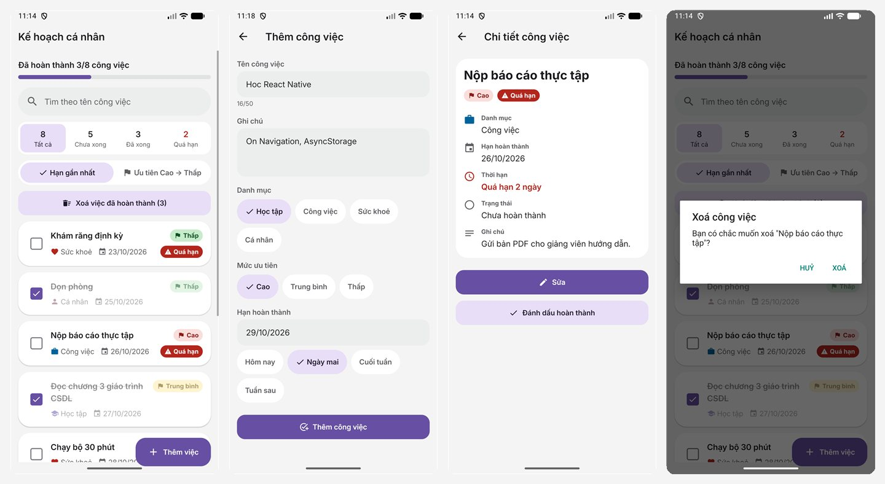

# PlannerApp – Quản lý kế hoạch cá nhân

Bài kiểm tra giữa kỳ môn **Phát triển ứng dụng di động đa nền tảng** (Đề 3), làm bằng **React Native CLI** (không Expo), TypeScript.



*Từ trái sang phải: danh sách, thêm việc (đang nhập), chi tiết việc quá hạn, xác nhận xoá.*

## Tính năng

- Danh sách `FlatList`: tiến độ "Đã hoàn thành X/Y", checkbox tự làm, nhãn ưu tiên đỏ/vàng/xanh, nhãn "Quá hạn".
- Thêm / sửa dùng chung một form, kiểm tra dữ liệu (tên ≤ 50 ký tự, ngày `dd/mm/yyyy` có thật, không trước hôm nay khi thêm mới), có chọn nhanh hạn.
- Xoá có xác nhận `Alert`: nhấn giữ một việc, hoặc xoá hàng loạt việc đã xong (kèm số lượng).
- Chi tiết: số ngày còn lại / quá hạn, đổi trạng thái, sửa.
- Lọc theo trạng thái (kèm số lượng), tìm kiếm không phân biệt hoa thường và dấu, sắp xếp theo hạn hoặc ưu tiên, dùng đồng thời.
- Lưu bằng AsyncStorage; lần chạy đầu có 8 việc mẫu.
- Giao diện: Material 3 kết hợp phong cách phẳng, font Inter, tất cả component tự dựng.

## Công nghệ

React Native 0.88, React Navigation (native-stack), react-native-screens, react-native-safe-area-context, AsyncStorage, react-native-vector-icons. Không dùng thư viện UI dựng sẵn.

## Chạy ứng dụng

```bash
npm install
npx react-native start
npx react-native run-android
```

Nếu cổng 8081 đang bị chiếm: `npx react-native start --port 8082`, rồi `cd android && ./gradlew installDebug -PreactNativeDevServerPort=8082` và `adb reverse tcp:8082 tcp:8082`.

Kiểm tra: `npm test` (111 test), `npx tsc --noEmit`, `npm run lint`.

## Cấu trúc

```
src/
  navigation/        stack và kiểu tham số
  features/tasks/    types, services (logic thuần), hooks, components, screens, tasks-context
  components/        ui (button, chip, text-field, search-bar, fab, snackbar...), states
  lib/               date, storage, id, confirm
  theme/             colors, metrics, fonts
```

## Tài liệu

- [Đề bài](docs/de-bai.md) và [bảng đối chiếu tiêu chí](docs/danh-gia-de-bai.md)
- [Kiến trúc](docs/architecture.md), [nghiệp vụ và logic](docs/business-logic.md)
- [Phong cách giao diện](docs/design-style.md), [tham chiếu Material 3](docs/material-3.md)
